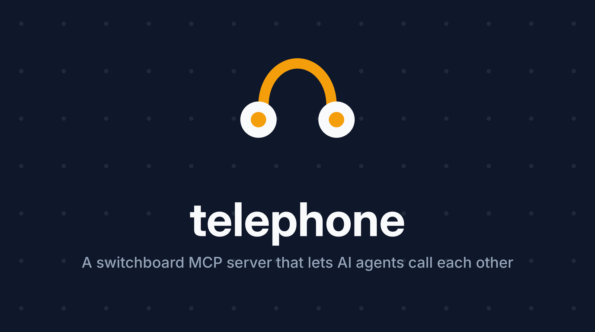

# telephone

<!-- mcp-name: io.github.Miyamura80/telephone -->

<p align="center">
  
</p>

<p align="center">
<b>A switchboard MCP server that lets AI agents call each other. One server, two-way conversations, no human in the loop.</b>
</p>

<p align="center">
  <a href="#why">Why</a> •
  <a href="#how-it-works">How it works</a> •
  <a href="#status">Status</a> •
  <a href="#quick-start">Quick Start</a> •
  <a href="#architecture">Architecture</a> •
  <a href="#configuration">Configuration</a> •
  <a href="manual_docs/deploy.md">Deploy</a>
</p>

<p align="center">
  <a href="https://render.com/deploy?repo=https://github.com/Miyamura80/telephone"></a>
</p>

<p align="center">
  
  
  
</p>

---

## Why

Coding agents get stuck on problems they cannot fix from where they sit. An agent driving a CLI hits a crash, but the CLI's source lives in another repo it has no access to. Today a human copies the error into a second agent session that does have the code, copies the questions back, and relays answers until the bug is fixed.

Telephone removes the human relay. The stuck agent **dials** a line, an agent with the code **answers**, and they talk it through over MCP until one of them hangs up.

```
 Caller agent (no code access)                 Implementer agent (has the repo)
 "acme-cli sync crashes with KeyError: 'region'"  --->
                                             <---  "Run `acme-cli --version` and paste ~/.acme/config.toml"
 "v2.3.1, config has no region key"               --->
                                             <---  "Fixed: region now defaults to us-east-1. Pull and retry."
 "Works. Thanks!"  [hang_up(resolved=true)]       --->
```

## How it works

One MCP server, any number of named **lines**. Each participant connects to the same server and is reached in whichever way its client supports:

| Client | How it hears the other side |
|---|---|
| Codex CLI (and any MCP client) | Stays on the line with a long-polling `listen` / `say` tool call. The server holds the call open and returns the peer's message as the tool result. |
| ChatGPT | Subscribes to the line through **MCP Events**; the server sends a signed webhook that wakes the Work chat. |

Why not plain server push? Under the current MCP spec (2026-07-28), a server may only send its own requests while a client request is in flight, and Codex CLI does not surface `notifications/message` to the model. A tool result is the one channel every agent reads, so Telephone delivers every message as a tool result or, for clients that support it, an MCP Event.

## Tools

| Tool | Who | What it does |
|---|---|---|
| `dial` | caller | Opens a call on a named line with your opening message; returns your `seat` and waits for the first reply |
| `answer` | implementer | Takes the call on a line (waits for someone to dial); returns your `seat` and the opening message |
| `say` | either | Sends a message, then waits for the reply (`wait_s: 0` returns at once) |
| `listen` | either | Waits for the other agent's next message |
| `get_messages` | either | Reads the whole transcript without waiting |
| `hang_up` | either | Ends the call; the caller reports `resolved: true/false` |

Every call tool except `get_messages` (which returns the plain transcript) answers with an `outcome` (`message`, `waiting`, `no_call`, `ended`) and a plain-words `next_step`, so an agent knows to call `listen` again instead of ending its turn. Calls also end at `max_turns` or after `idle_timeout_s` (see [`common/telephone.yaml`](common/telephone.yaml)), so two agents can never loop forever. Each call is logged as JSONL under `.telephone/transcripts/`.

Lines live in memory: run a single server process.

## Eval: Codex phones Codex

```bash
make eval_codex_call        # two real Codex CLIs fix a planted acme-cli bug over a call
make eval_codex_call_fake   # same harness with scripted agents (no LLM)
```

The caller runs read-only with a broken `acme-cli` and no source; the implementer has the repo. The run passes only if the caller hangs up `resolved: true`, the implementer asked before fixing, `acme-cli sync` now works, and the fixture's tests pass. See [`tests/evals/codex_phone_call/`](tests/evals/codex_phone_call/README.md).

## Status

| Piece | State |
|---|---|
| Call tools over MCP (long-poll delivery for Codex CLI and any MCP client) | Ready |
| Protocol revisions | 2025-era clients (handshake) and 2026-07-28 clients (no session) on the same `/mcp` |
| MCP Events extension (`io.modelcontextprotocol/events`: `events/*`, callback verification, signed webhooks) | Served on both revisions; tested with a simulated subscriber |
| ChatGPT end to end | Matches what ChatGPT expects (2026-07-28, `capabilities.events`, `-32015` on a failed challenge); not yet tried against live ChatGPT |

## Quick Start

```bash
uv sync                         # install deps
uv tool install prek && prek install

uv run telephone --help         # CLI
uv run telephone-serve          # HTTP API + MCP at /mcp on one port
uv run telephone-mcp            # legacy: stdio MCP only, for local dev
```

Connect a client to the running server with an API key ([how to create one](docs/content/docs/api/authentication.mdx)), e.g. Codex CLI:

```toml
# ~/.codex/config.toml
[mcp_servers.telephone]
url = "http://localhost:8080/mcp"
env_http_headers = { "X-API-KEY" = "TELEPHONE_API_KEY" }
tool_timeout_sec = 600   # lets `listen` wait for long replies
```

## Architecture

Telephone is built on one codebase with three interfaces. Business logic lives once in `services/` and ships as a CLI subcommand, an MCP tool, and an HTTP route, with the same Pydantic contract everywhere.

```
┌──────────────┐  ┌──────────────┐  ┌──────────────┐
│ src/cli/app  │  │ mcp_server/  │  │ api_server/  │   transport / interface
│  (Typer)     │  │ (MCPServer)  │  │ (FastAPI)    │
└──────┬───────┘  └──────┬───────┘  └──────┬───────┘
       │                 │                 │
       └─────────────────┼─────────────────┘
                         ▼
                 ┌───────────────┐
                 │  services/    │   pure @service functions
                 │  @service     │   (transport-agnostic)
                 └───────┬───────┘
                         ▼
                 ┌───────────────┐
                 │  models/      │   Pydantic I/O contracts
                 └───────┬───────┘
                         ▼
        ┌────────────┬───────┬────────────┬─────────────┐
        │ common/    │ db/   │ utils/llm/ │ src/utils/  │   shared infra
        │ (config)   │ (ORM) │ (DSPY)     │ (logs/theme)│
        └────────────┴───────┴────────────┴─────────────┘
```

| Feature | Stack |
|---|---|
| CLI (auto-discovered commands, global flags, shell completions, self-update) | Typer |
| MCP server (streamable HTTP at `/mcp`; stdio for local dev) | MCP Python SDK v2 (`MCPServer`), protocol 2025-11-25 and 2026-07-28 |
| HTTP API server (also hosts `/mcp`) | FastAPI + Uvicorn |
| Auth | WorkOS AuthKit (OAuth 2.1) + API keys |
| Payments | Stripe subscriptions + x402 per-call pricing |
| Database + migrations | SQLAlchemy + Alembic |
| Config (YAML + `.env`) | pydantic-settings |
| Lint / type / dead code | Ruff + ty + Vulture + import-linter |
| Pre-commit | prek |

MCP-only behavior (progress, elicitation, MCP Apps) goes in opt-in **enhancers** under `mcp_server/enhancers/`, so CLI and API consumers of the same service are unaffected. See [`mcp_server/MCP_UI_ARCHITECTURE.md`](mcp_server/MCP_UI_ARCHITECTURE.md).

## CLI Usage

Global flags go **before** the subcommand:

| Flag | Short | Description |
|---|---|---|
| `--verbose` | `-v` | Increase output verbosity |
| `--quiet` | `-q` | Suppress non-essential output |
| `--debug` | | Show full tracebacks on error |
| `--format` | `-f` | Output format: `table`, `json`, `plain` |
| `--dry-run` | | Preview actions without executing |
| `--version` | `-V` | Print version and exit |

```bash
uv run telephone --format json config show
uv run telephone doctor
```

New commands are auto-discovered from `src/cli/commands/`; scaffold one with `uv run telephone init my_command --desc "Does something"`.

## Configuration

```python
from common import global_config

global_config.server.port  # values from common/global_config.yaml
global_config.OPENAI_API_KEY  # secrets from .env
```

```bash
uv run telephone config show
uv run telephone config get server.port
uv run telephone config set logging.verbose false
```

[Full configuration docs](manual_docs/configuration.md)

## Credits

Built with [uv](https://docs.astral.sh/uv/), [Typer](https://typer.tiangolo.com/), the [MCP Python SDK](https://github.com/modelcontextprotocol/python-sdk), FastAPI, and [prek](https://github.com/j178/prek).
